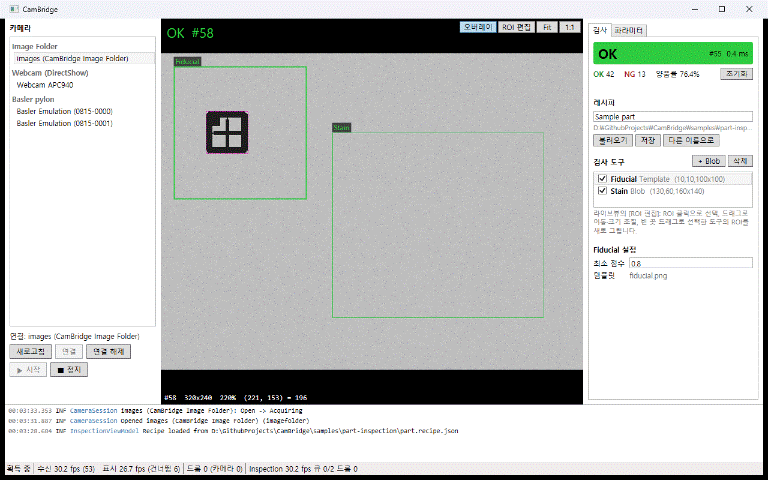
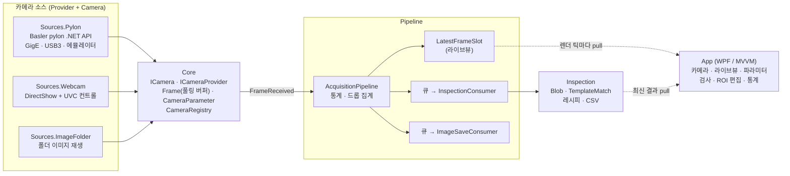

# CamBridge

멀티벤더 머신비전 카메라 연동 데모 (.NET 8 / WPF)

카메라 제조사가 바뀌어도 획득·검사·UI 로직이 그대로 동작하도록 설계한 카메라 연동 프레임워크와 데모 애플리케이션입니다. Basler pylon(GigE / USB3 Vision, 에뮬레이터), UVC 웹캠, 이미지 폴더를 같은 인터페이스로 다루고, 프레임 드롭 없는 획득 파이프라인 위에서 ROI 기반 양불(OK/NG) 검사까지 이어집니다.

**검사 시연** — 샘플 부품 20장을 30 fps로 재생하며 실시간 OK/NG 판정(양품률 75% = 샘플 구성 15/5). ROI 편집 모드에서 얼룩 검사 영역을 마우스로 옮기고 키우면 실행 중에 바로 반영됩니다.



**멀티벤더 전환** — 같은 화면에서 이미지 폴더를 끊고 Basler pylon 에뮬레이터에 연결합니다(1024×1040, 약 96 fps, 드롭 0). 파라미터 패널에는 노출(µs)·게인(dB)·트리거와 카메라가 제공하는 GenICam 노드가 그대로 나타납니다. 상위 코드는 카메라 종류를 모릅니다.


## 주요 기능

- **공통 카메라 추상화** — `ICamera` / `ICameraProvider` 하나로 Basler pylon, DirectShow 웹캠, 이미지 폴더를 다룹니다. 새 제조사는 Provider 하나만 추가하면 상위 코드 수정 없이 UI에 나타납니다.
- **GenICam 방식 파라미터** — 노출·게인·트리거는 강타입 속성으로, 그 외 노드는 이름 기반(`GetParameter("ExposureTime")`)으로 접근합니다. SFNC 2.x 이름(`ExposureTime`, `Gain`)과 구형 카메라의 SFNC 1.x 이름(`ExposureTimeAbs`, `GainRaw`)을 자동으로 대응시킵니다.
- **트리거** — Free-run, 소프트웨어 트리거, 하드웨어 트리거(입력 라인 선택).
- **드롭 없는 획득 파이프라인** — 카메라 콜백은 버퍼 참조만 넘기고, 검사·저장은 소비자별 큐에서 처리합니다. 큐 상한과 초과 정책(오래된 것 버림 / 새것 버림 / 대기)을 고를 수 있습니다.
- **통계 상시 표시** — 수신 FPS, 표시 FPS, 소비자별 처리 FPS·큐 길이·드롭, 카메라측 드롭(block ID 공백)을 상태바에 항상 보여 줍니다.
- **양불 검사** — 이진화 + 블롭(개수·면적), 템플릿 매칭(점수). ROI를 라이브뷰에서 마우스로 그리고 옮기면 실행 중에 바로 반영됩니다. 레시피는 JSON으로 저장·불러오기, 결과는 CSV로 기록할 수 있습니다(Core).
- **라이브뷰** — 최신 프레임만 표시(중간 프레임 건너뜀), 휠 줌·팬, 픽셀 좌표·값 표시, OK 녹색 / NG 빨강 오버레이.

## 구조



| 프로젝트 | 대상 | 역할 |
|---|---|---|
| `CamBridge.Core` | net8.0 | 인터페이스·모델만. 벤더 SDK·OpenCV 타입 없음 |
| `CamBridge.Pipeline` | net8.0 | 획득 파이프라인, 소비자 큐, 통계, 이미지 저장 |
| `CamBridge.Inspection` | net8.0 | ROI 검사 도구, 판정, 레시피, CSV 로그 |
| `CamBridge.Sources.ImageFolder` | net8.0 | 폴더 이미지를 카메라처럼 재생 (Free-run / 소프트웨어 트리거) |
| `CamBridge.Sources.Webcam` | net8.0-windows | DirectShow 캡처, IAMCameraControl/IAMVideoProcAmp로 노출·게인 등 |
| `CamBridge.Sources.Pylon` | net8.0-windows | Basler pylon (SDK가 없으면 지원 없이 빌드) |
| `CamBridge.App` | net8.0-windows | WPF 데모 앱 |
| `tests/CamBridge.Tests` | net8.0 | 크로스플랫폼 단위·통합 테스트 (CI) |
| `tests/CamBridge.Tests.Windows` | net8.0-windows | 웹캠·pylon 에뮬레이터·UI 계산 테스트 (장치가 없으면 Skip) |
| `tools/CamBridge.SampleGenerator` | net8.0 | 시연용 샘플 이미지·레시피 생성 |
| `tools/CamBridge.Soak` | net8.0-windows | 장시간 실행 메모리·드롭 검증 |

## 설계 원칙과 근거

| 원칙 | 구현 |
|---|---|
| Core는 순수하게 | Core는 SDK·OpenCV를 참조하지 않습니다. pylon 타입은 `PylonCamera` 밖으로 나가지 않습니다. |
| 프레임 콜백에서 블로킹 금지 | 카메라 스레드에서는 버퍼를 풀에 복사하고 참조를 넘길 뿐, 디스크 I/O·검사·UI 접근을 하지 않습니다. |
| 버퍼 소유권 명확히 | `Frame`은 참조 카운트 핸들(`Share()` / `Dispose()`)이고 버퍼는 `ArrayPool`로 돌려줍니다. |
| UI 스레드 마샬링 | 라이브뷰·검사 결과·통계는 UI가 자기 주기로 가져갑니다(pull). 카메라·검사 스레드는 Dispatcher를 호출하지 않으므로 UI가 느려도 획득이 느려지지 않습니다. |
| SDK 없이도 빌드 가능 | pylon은 조건부 참조 + 항상 컴파일되는 `PylonProviderFactory`. SDK가 없는 PC에서도 빌드·실행되고 pylon만 빠집니다. |
| 통계는 항상 노출 | 카메라측 드롭은 block ID 공백으로 셉니다(GigE의 16비트 순환 처리 포함). |

실행 중 레시피 변경은 검사 엔진을 통째로 새로 만들어 소비자에게 넘기고, 소비자가 다음 프레임 전에 교체합니다. 스레드 안전하지 않은 엔진을 두 스레드가 동시에 쓰는 일이 없습니다.

## 측정 결과

pylon 카메라 에뮬레이터 30분 장시간 실행 (`tools/CamBridge.Soak`, 640×480 Mono8, 검사 + PNG 저장 + 라이브뷰 pull, Release):

| 항목 | 결과 |
|---|---|
| 프레임 | 167,184장, 카메라 드롭 0, 전체 드롭 0 |
| 남은 관리 힙 (강제 GC 후) 증가 | +0.025 MB/분 (7.7~9.3 MB 사이 진동) |
| Private bytes 증가 | +0.012 MB/분 (107.9 → 108.0 MB) |
| 핸들 / 스레드 | 536 / 31에서 변화 없음 |
| 미반환 프레임 버퍼 | 실행 중 최대 1, 정지 후 0 |
| 자연 발생 GC | 0회 (프레임 버퍼 풀링) |

앱에서: pylon 에뮬레이터 1024×1040 수신 약 96 fps·드롭 0, 샘플 폴더 검사 30 fps·검사 1회 0.3~0.4 ms, 웹캠 640×480 30 fps.

실물 카메라 결과는 아래 [현재 상태](#현재-상태)에 있습니다.

## 요구 사항

- Windows 10/11, .NET 8 SDK
- Basler 카메라 사용 시: [Basler pylon Camera Software Suite](https://www.baslerweb.com/) (pylon 26.09.2에서 확인). 이 저장소에는 SDK 파일을 포함하지 않습니다.
- 웹캠 사용 시: UVC 웹캠 (DirectShow)

## 빌드와 실행

```
dotnet build CamBridge.sln
dotnet run --project src/CamBridge.App
```

- pylon SDK가 설치되어 있으면 `PYLON_DEV_DIR` 환경변수로 자동 감지합니다(`Assemblies\Basler.Pylon\net8.0\x64\Basler.Pylon.dll`). 경로가 다르면 `dotnet build -p:PylonNetAssembly="<경로>\Basler.Pylon.dll"`로 지정합니다.
- pylon 에뮬레이터를 쓰려면 앱 실행 전에 `set PYLON_CAMEMU=2`를 설정합니다. 카메라 목록의 "Basler pylon" 아래에 에뮬레이션 카메라 2대가 나타납니다.
- 앱은 시작 시 `samples/part-inspection`의 이미지 폴더와 레시피를 불러옵니다. 카메라 목록에서 `images`를 연결하고 시작하면 바로 검사 시연이 됩니다.
- 다른 이미지로 검사를 구성하려면 카메라 패널의 [폴더 추가]로 폴더를 고릅니다. 샘플 레시피는 시작점으로만 쓰이며, [저장]은 덮어쓰지 않고 저장 위치를 묻습니다. 한 폴더의 이미지는 크기가 같아야 합니다.
- 환경변수가 없는 셸에서는 시스템에 저장된 `PYLON_DEV_DIR`을 읽습니다. SDK가 있는 PC에서 SDK 없이 빌드해 보려면 `-p:PylonNetAssembly=none`을 쓰고, 그 뒤 다시 SDK로 빌드할 때는 `--no-incremental`을 붙입니다(앱의 deps.json 갱신).

## 테스트

```
dotnet test tests/CamBridge.Tests            # 크로스플랫폼 (CI에서 실행)
dotnet test tests/CamBridge.Tests.Windows    # 웹캠·pylon 에뮬레이터·UI 계산 (장치가 없으면 Skip)
dotnet run -c Release --project tools/CamBridge.Soak -- --minutes 30   # 장시간 실행 (실물 카메라, 에뮬레이터는 --emulator)
```

## 새 카메라 제조사 추가하기

예: HIKROBOT(MVS SDK)

1. `src/CamBridge.Sources.Hik` 프로젝트를 만들고 `CamBridge.Core`만 참조합니다. SDK는 pylon과 같은 방식으로 조건부 참조해 SDK가 없는 PC에서도 빌드되게 합니다.
2. `ICameraProvider`를 구현합니다. `EnumerateAsync`는 장치를 찾아 `CameraInfo`(고유 `DeviceId`, 인터페이스 종류)를 돌려주고, `Create`는 카메라 객체를 만듭니다.
3. `ICamera`를 구현합니다.
   - SDK 콜백에서 이미지 버퍼를 `Frame.Rent` 버퍼로 복사하고 `FrameReceived`를 올립니다. 콜백 안에서 오래 걸리는 일은 하지 않습니다.
   - `FrameId`에는 카메라의 프레임 번호(block ID)를 넣어야 전송 손실이 드롭 통계에 잡힙니다.
   - 노출·게인·트리거를 SDK 노드에 대응시키고, 나머지 노드는 `GetParameters` / `GetParameter` / `SetParameter`로 노출합니다. 없는 이름은 `KeyNotFoundException`, 지금 쓸 수 없는 값은 `InvalidOperationException`, 범위 밖은 `ArgumentOutOfRangeException`으로 다른 소스와 같은 규약을 따릅니다.
   - 분리되면 `ErrorOccurred(Disconnected)`를 올리고 `Faulted` 상태로 바꿉니다.
4. `App.xaml.cs`의 `CreateProviders()`에 Provider를 등록합니다. 파이프라인·검사·UI는 바뀌지 않습니다.
5. `tests/CamBridge.Tests.Windows`의 pylon 에뮬레이터 테스트를 본떠 상태 전이, 파라미터, Free-run 프레임 번호, 트리거를 검증합니다.

## 샘플 데이터

`samples/part-inspection/`의 시연용 샘플은 직접 생성한 합성 이미지라 라이선스 제약이 없습니다.

- `images/` — 부품 이미지 20장(OK 15 / NG 5). 파일명에 기대 판정(`_ok`, `_ng`)이 들어 있습니다.
- `part.recipe.json` — 검사 레시피(기준 마크 템플릿 매칭 + 얼룩 블롭 검사)
- `fiducial.png` — 템플릿 이미지

다시 만들려면 `dotnet run --project tools/CamBridge.SampleGenerator`를 실행합니다.

## 현재 상태

- 웹캠, 이미지 폴더, pylon 에뮬레이터로 획득·검사·UI 전체 흐름을 구현하고 검증했습니다.
- 실물 Basler GigE 카메라(acA640-120gm, pylon 26.09.2)로 연결, SFNC 1.x 노드 이름, 파라미터 제어, 케이블 분리 감지(약 1.5초)와 재연결을 확인했습니다. 검증 테스트는 `PylonRealCamera`, NIC 설정 스크립트는 `tools/camera-nic.ps1`입니다.
- 실물 30분 실행(640×480 Mono8, 120fps, 검사 + 1/100 PNG 저장): 216,160프레임 수신, 전체 드롭 0(카메라측 0), 패킷 손실·재전송 0, 메모리 증가 없음. 1차 실행에서 저장 큐 드롭 2개를 발견해 저장할 프레임만 큐에 넣도록 고친 뒤의 결과입니다. 1차에서 저장이 지연된 원인 자체는 확인하지 못했습니다.
- 남은 일: 실제 대상물과 조명으로 검사 시연, 실물 시연 영상.

작업 계획과 진행 상황은 [docs/PLAN.md](docs/PLAN.md)를 참고하세요.
